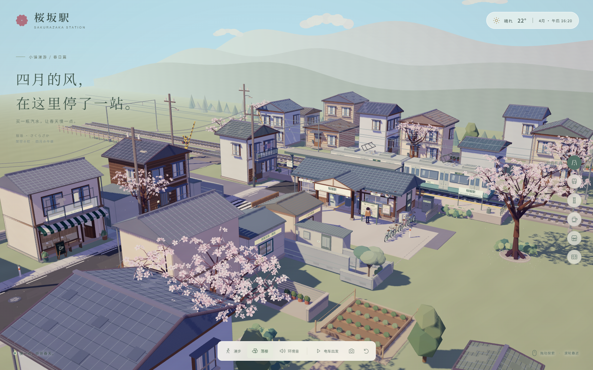
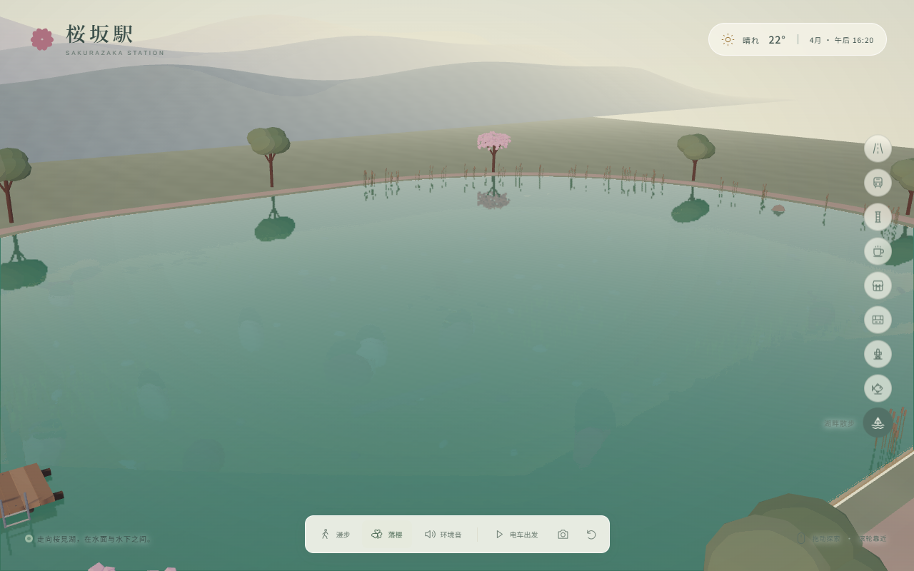

# 桜坂駅 · 四月的风

[](LICENSE)



一个用 Three.js 构建的三渲二樱花车站。真实三维街区配合四级明暗、冷紫阴影、暖色阳光、细轮廓和低频笔触。建筑、树木、铁轨、电车与室内陈设由程序生成，不需要外部模型或照片。

## 运行

需要 Node.js 22.12 或更新版本。

```bash
git clone https://github.com/08102317cdw-art/sakurazaka-station.git
cd sakurazaka-station
npm ci
npm run dev
```

打开终端显示的本地地址。生产构建使用 `npm run build`，预览构建使用 `npm run preview`。

运行 `npm test` 可验证水波稳定性、鱼食浮力、跳跃与泳潜碰撞、湖底地形、鱼群运动及钓鱼循环；这些测试无需浏览器。浏览场景需要支持 WebGL 2 的现代浏览器，手机也可以使用触屏操作。

## 浏览方式

默认采用俯瞰浏览，可以旋转、靠近街区，也可以点击底部“漫步”，从任何观察视角进入第一人称。漫步时保留落樱、环境音、电车与拍照控制，点击“俯瞰”回到观察模式。

第一人称漫步：

- 电脑使用 WASD 或方向键移动，鼠标环顾，按住 Shift 快走；按 Esc 释放鼠标。
- 鼠标未锁定时可以拖动画面环顾，再点击画面重新锁定。内嵌浏览器不支持锁定时，拖动和键盘移动仍然可用。
- 手机使用左下摇杆移动，松开停止；拖动右半画面环顾。底部按钮始终可用。
- 空格跳跃，重力会让角色落回真实踏面；墙体、屋顶、门洞、楼梯和升降舱地板均参与碰撞。
- 靠近物件并朝向它，按 E 或轻触屏幕上的互动按钮。住宅门、收音机、咖啡、面包、明信片架、食堂菜单和售票机都可互动，物件会出现开门、调谐、端出食物或打印车票等变化。
- 14 栋住宅（包含后街远处住宅）、四家店铺、农具棚、三个巷道附属间和站内房间均有可进入的真实室内。12 处二层空间通过楼梯上下，透过窗户能观察街景。
- 车站东侧步道通向桜坂观光塔。在升降舱按钮前互动，上行约 10 秒抵达 17.8 米展望台；开门后可走出舱、沿平台漫步，再乘舱回到地面。升降中可以自由环顾。

天气与昼夜：

- 点击右上天气标记，选择晴天、薄云或春雨；时间滑杆和清晨／正午／黄昏／夜晚按钮可调整时刻。“让时间流动”开启自动昼夜循环，约六分钟经过一天。
- 阳光方向、色温、阴影、天空、星月和雾色随时刻变化，车站机械时钟同步更新。夜间亮起街灯、住宅窗灯和店铺室内灯。
- 雨滴受重力、终端速度与阵风影响，在真实瓦屋顶、遮阳篷和地面上碰撞，产生飞溅与涟漪；屋顶下会遮雨。积水沿路缘低点逐渐长大，反射天色，停雨后慢慢变干。
- 风同时影响雨线、落樱、晾晒衣物和布篷；雨声在室内衰减，雨天与夜间减少鸟鸣。

鱼塘漫游：

- 新增西侧锦鲤池、东南养鱼塘和西北山麓湧水池。主街南端的生活步道与道口外的小径通向三座塘；点击右侧“水边鱼塘”可直接观察锦鲤池。
- 真实开挖的池底、缓坡、石岸、芦苇与木栏构成完整水域；可以走上投喂平台和北塘角落的小木桥，也可以跳入塘中游泳、潜入观察锦鲤。
- 共 23 条立体鲤鱼和锦鲤，持续游动、摆鳍、转向、避岸与避让同伴。在平台附近朝向水面按 E 或轻触互动按钮投喂，鱼食受重力落水、随波漂浮，鱼群上浮并逐粒进食。
- 水面使用有固定时间步长与 CFL 稳定控制的浅水波高度场，鱼尾、鱼食、进水口和真实雨滴进入同一扰动状态，波纹会传播、在岸边反射并衰减；浅岸与桥桩对应求解边界。
- 反射与透射来自真实场景离屏渲染，折射包含水底深度；水的折射率为 1.333，Fresnel 控制视角反射，水中路径吸收控制深浅水色，太阳高光随昼夜变化。池底与卵石焦散由同一波面法线的折射聚焦推导。
- 这是实时水面高度场与物理光学近似；技术参考、采用方式与模型边界见 [水面参考记录](docs/water-references.md)。

湖畔、游泳与垂钓：



- 镇东步道通向约 68×54 米的桜見湖，最深约 9.6 米。点击右侧“湖畔散步”，再点“漫步”，即可从开放浅滩开始探索；环湖小径、木栈桥和两处钓点可步行到达。
- 入水后逐渐切换泳姿，WASD 顺着视线游动；空格上浮，C 或 Ctrl 下潜。松开潜水按键可保持深度，沿浅滩游回即可站起。手机摇杆配合“上浮”和“下潜”按钮操作。
- 入水飞溅、游动尾波、漂浮鱼食和雨滴共同驱动水波。水下有随深度和观察距离变化的颜色吸收、上升气泡，以及水面折射和全反射；湖底可以找到沉船、沉木、水草、石块和 32 条分层游动的鱼。
- 靠近钓鱼牌按 E 或轻触互动抛竿。浮漂下沉时按 E 抬竿，再按住 E 或“收线”按钮；张力偏高时松手，降低张力后继续。钓获后可以放回湖中，离开码头、入水或退出漫步会自动收竿。
- 跳跃、泳潜与鱼群使用固定物理步长；鱼食和浮漂受重力、浮力、水阻与真实波面影响。水下拍照会保留当前水色与视野。

俯瞰浏览与公共控制：

- 拖动旋转，滚轮缩放；触屏单指旋转，双指缩放和平移。
- 右侧切换站前街道、樱花站台、铁路道口、街角店铺、巷口杂货、站内售票、观光塔、水边鱼塘和湖畔散步九个视角。
- 初始时刻为四月下午 16:20，站房时钟与页面时间一致。三条窄巷保留通行空间，可发现管线、后院和可以摸摸的小猫。
- 底部可切换落樱和风声鸟鸣，让电车出发，保存完整 PNG 画面或恢复视角。
- 电车驶离后会从远方返回；再次点击“返回停靠”立即复位。道口栏杆与信号灯随电车运行联动。
- 俯瞰模式下按 Esc 恢复初始视角。系统启用减少动态效果时，默认关闭飘樱并取消视角过渡。

## 文件

- `src/main.js`：场景、日光、视角与交互。
- `src/walk.js`：第一人称移动、鼠标环顾与触屏摇杆。
- `src/walk-world.js`：街区碰撞边界、台阶与地面高度。
- `src/interactions.js`：近距离视线选择、E 键与触屏互动、阅读纸卡。
- `src/environment.js`：天气控制、太阳与月亮、时间循环、灯光和声音联动。
- `src/weather-effects.js`：真实接雨面、受风雨滴、撞击飞溅、涟漪与积水。
- `src/ponds.js`：三座鱼塘的开挖岸坡、鱼群、投喂、步道与木桥。
- `src/pond-shape.js`：地面开孔、水面和深水步行边界共用的岸线。
- `src/water-simulation.js`：固定步长水波求解、岸边阻尼、风与局部扰动。
- `src/water-renderer.js`：水面位移、真实反射与深度折射、Fresnel、吸收、高光和池底焦散。
- `src/water-world.js`：统一水域查询、真实池底采样与水深。
- `src/lake.js`：大湖岸坡、栈桥、钓点、水下地标与分层鱼群。
- `src/underwater.js`：水下光程吸收、入水飞溅、潜泳气泡及水下截图。
- `src/fishing.js`：抛竿、浮漂浮力、咬钩、钓线张力、收线与放鱼。
- `src/tower.js`：观光塔结构、可走平台、玻璃升降舱和乘坐状态。
- `src/street-interactions.js`：贩卖机汽水与散步地图。
- `src/home-interiors.js`：住宅门、厨房与生活家具、楼梯、二层室内和夜灯。
- `src/shop-interiors.js`：咖啡店与面包店二层阅读和休息空间。
- `src/kit.js`：三渲二材质、细轮廓、字牌、基础几何与静态合并。
- `src/street.js`：道路、排水沟、井盖、标线、电线杆和人物。
- `src/town.js`：错落住宅、阳台、屋瓦、院落与后巷。
- `src/residential-details.js`：住宅管线、门口设施与园艺用品。
- `src/shops.js`：喫茶こもれび、面包店及可见室内陈设。
- `src/daily-shops.js`：青葉文具杂货店、こはる食堂与日常商品。
- `src/alleys.js`：三条窄巷、储物间、后院、藤蔓与小猫。
- `src/station.js`：前后贯通的站房、售票区、双通道检票口、站台、电车和道口。
- `src/nature.js`：带缺口与微弯花瓣的实例化五瓣樱花、树边落樱、草木、远山和薄云。
- `src/audio.js`：本地合成环境声音。

字体优先使用 Noto 系列，网络不可用时自动使用本地中文与日文字体。

## 开源许可与参考

本项目以 [MIT 许可证](LICENSE) 开源，允许使用、修改与再分发，需保留许可证与版权声明。第三方组件适用各自的许可证，归属说明见 [三方许可证](docs/THIRD_PARTY_NOTICES.md)。水面技术参考及实时物理模型的范围见 [水面参考记录](docs/water-references.md)。
